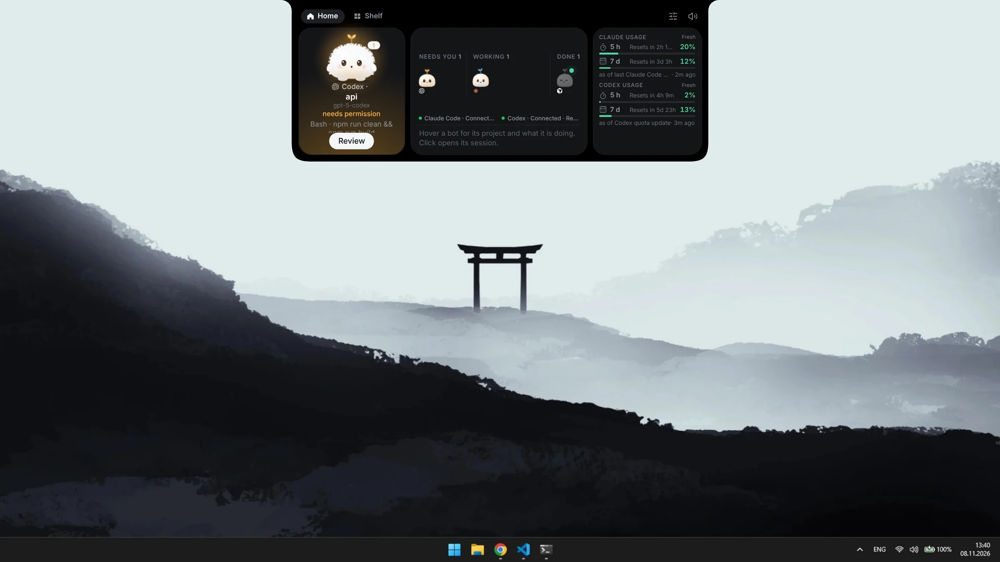
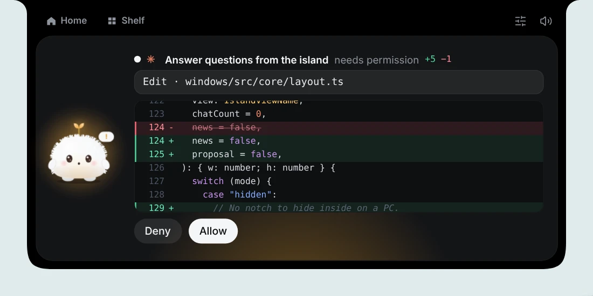
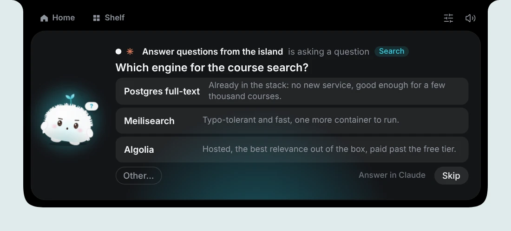
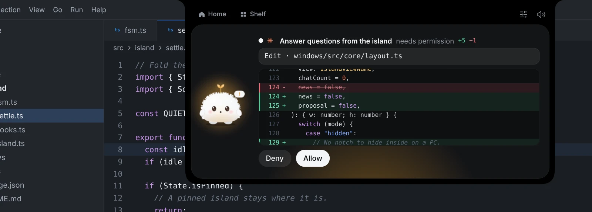
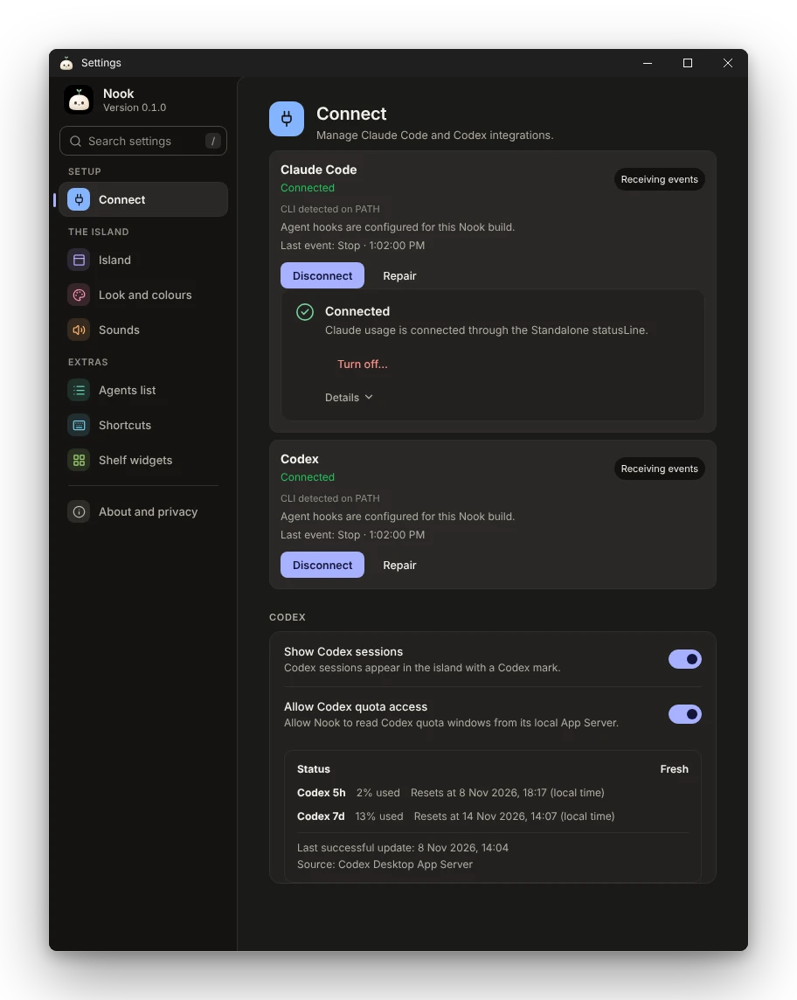

<div align="center">


# Nook Personal Edition

### Your AI workflow. One elegant island.

Keep Claude Code and OpenAI Codex in sight without leaving your work.<br>
Monitor sessions, usage limits, permission requests and notifications from a lightweight Windows desktop island.

<br>

[](https://github.com/valenticus/nook/releases/latest)
[](LICENSE)
[](#requirements)

<br>

<picture><source media="(prefers-color-scheme: light)" srcset="docs/images/personal-edition/hero-light.webp"></picture>

</div>

> [!NOTE]
> Nook Personal Edition is an independent fork and is not affiliated with or endorsed by Anthropic, OpenAI, or the original Nook author.

## Quick overview

- **See every session:** Claude Code and Codex activity, waiting requests, errors and finished turns in one island.
- **Answer from the island:** review and answer supported permission requests; edits show a diff.
- **Watch your limits:** Claude Code and Codex 5-hour and 7-day usage, rotating in the folded island.
- **Stay local:** no account of its own; Connect previews every change and backs up files first.

Nook Personal Edition 0.1.0 is a personal fork of [Nook](https://github.com/zubairbinshaukat/nook), created by **Zubair Bin Shaukat**. It has its own application identity and per-user data paths, so it can be installed separately from Original Nook. See the [0.1.0 release notes](RELEASE_NOTES-v0.1.0.md).

## Features

- **Claude Code and Codex sessions:** see activity, waiting requests, errors, and completed turns in the island.
- **Permission requests:** review and answer supported requests from Nook. Codex may require a separate trust approval in Codex itself.
- **Usage limits:** Claude Code 5-hour and 7-day limits through Claude's status line; Codex 5-hour and 7-day limits through the local Codex App Server provider. Codex quota access is opt-in in Settings.
- **Compact quota indicators:** when both providers have usable data, the compact island rotates between Claude and Codex every five seconds. Missing values are not shown as zero.
- **Idle clock and battery:** after five minutes without relevant activity, the compact island can show local time and available battery/charging status. Nook does not estimate time to full charge when Windows provides no reliable value.
- **Gullu, themes, and colors:** the animated companion and appearance options are available in Settings.
- **Completion and important alerts:** completed turns use a temporary card and sound; permission requests and important errors remain visible for attention.
- **English and Ukrainian:** choose a language in Settings or follow the system language.

## Screenshots

<table>
<tr>
<td width="50%" align="center"><picture><source media="(prefers-color-scheme: light)" srcset="docs/images/personal-edition/approval-diff-light.webp"></picture><br><sub>Approve an edit with its diff. Nothing is approved without your click.</sub></td>
<td width="50%" align="center"><picture><source media="(prefers-color-scheme: light)" srcset="docs/images/personal-edition/question-light.webp"></picture><br><sub>Answer an agent's question from the island.</sub></td>
</tr>
<tr>
<td width="50%" align="center"><picture><source media="(prefers-color-scheme: light)" srcset="docs/images/personal-edition/compact-claude-light.webp"></picture><br><sub>Folded: Claude's usage ...</sub></td>
<td width="50%" align="center"><picture><source media="(prefers-color-scheme: light)" srcset="docs/images/personal-edition/compact-codex-light.webp"></picture><br><sub>... and Codex's. The island rotates between them every five seconds.</sub></td>
</tr>
<tr>
<td width="100%" align="center" colspan="2"><picture><source media="(prefers-color-scheme: light)" srcset="docs/images/personal-edition/over-editor-light.webp"></picture><br><sub>The island floats over your editor, so it never takes space from it.</sub></td>
</tr>
<tr>
<td width="100%" align="center" colspan="2"><picture><source media="(prefers-color-scheme: light)" srcset="docs/images/personal-edition/settings-connect-light.webp"></picture><br><sub>Settings → Connect: both agents, Claude usage and Codex quota.</sub></td>
</tr>
</table>

Pictures follow your GitHub theme. They show Nook's own interface with made-up sessions and no personal data; sizes and descriptions are listed in [docs/images/personal-edition/manifest.json](docs/images/personal-edition/manifest.json).

## Requirements

- 64-bit Windows. Windows 11 is the tested platform. Windows 10 has not been tested for this edition; compatibility is neither confirmed nor ruled out.
- WebView2 Runtime, included with supported Windows installations.
- Claude Code and/or Codex installed separately for the corresponding agent integration.
- For Codex usage quotas, Codex CLI 0.165.0 or newer and an available Codex account/session. Quota access must be enabled in Nook Settings.
- Claude usage limits require Claude Code's status line to be connected to Nook. A project or managed status-line override may take precedence; Connect reports scope conflicts for review.

Nook does not require an account of its own. It does not provide Claude or Codex access or credentials.

## Install

1. Download `Nook-Personal-Edition-0.1.0-setup.exe` and `SHA256SUMS.txt` from the [Nook Personal Edition releases](https://github.com/valenticus/nook/releases/latest).
2. Verify the installer hash in PowerShell:

   ```powershell
   Get-FileHash .\Nook-Personal-Edition-0.1.0-setup.exe -Algorithm SHA256
   ```

   Compare the SHA-256 value with the installer entry in `SHA256SUMS.txt`.
3. Run the installer and follow its prompts. The installer is currently unsigned; see [Windows security notice](#windows-security-notice).
4. Open **Settings → Connect**, choose Claude Code or Codex, review the preview, and confirm only the changes you want. Nook handles its hook configuration; do not edit or delete hook entries manually.
5. Codex can ask you to trust its newly detected hooks. Review and approve that request in Codex itself; Nook does not bypass Codex trust.

Claude sessions and usage statistics are separate Connect options. Claude usage requires its status line; the preview explains any scope conflict before changes are applied. Third-party and unknown configuration entries are preserved.

## Agent integration and usage limits

Open **Settings → Connect**, choose Claude Code or Codex, review the preview and confirm only the changes you want. Nook backs up the files it changes and preserves third-party and unknown entries.

- **Claude usage:** 5-hour and 7-day limits come through Claude Code's status line. A project or managed status-line setting may take precedence; Connect reports the conflict for review.
- **Codex usage:** 5-hour and 7-day limits come from the local Codex App Server. This is opt-in in Settings.
- **Compact island:** when both providers have usable data, it rotates between Claude and Codex every five seconds. Missing values are never shown as zero.
- **Codex trust:** Codex may ask you to trust the newly detected hooks. Approve that in Codex itself; Nook does not bypass it.

## Settings and personalization

Gullu, the animated companion, themes and colors, English or Ukrainian (or follow the system language), sounds for finished turns, and an optional idle clock and battery in the compact island are all in **Settings**.

## Known limitations

- Nook cannot show a trustworthy estimated time to full charge unless Windows supplies one; the current battery provider does not provide that estimate.
- Codex hook delivery starts only after Codex's own trust approval when requested. Codex usage quotas require the supported CLI, an available quota response, and the opt-in setting.
- Claude usage can be affected by a higher-priority project or managed status-line configuration. Nook shows the conflict for review and does not silently modify those settings.
- There is no in-app updater. Check the Personal Edition Releases page for updates and verify each download with its published checksum.
- Windows may warn about the unsigned installer. See below.
- Start with Windows is optional, and its behavior is still being verified.
- Codex quota recovery after a reset (the window returning to 0% used) is covered by automated tests. It has not yet been confirmed manually against a live Codex account.

## Privacy and security

Nook runs locally and connects to agent integrations through their supported hooks and local Codex App Server. Connect shows a preview and takes a backup before applying supported changes. Use **Settings → Connect** to connect or disconnect Nook; do not remove hook entries by hand. Codex usage access is optional.

### Windows security notice

The installer is not digitally signed. Windows SmartScreen may show **“Windows protected your PC”** or identify the publisher as unknown. Verify that the installer came from the `valenticus/nook` Personal Edition release page and that its SHA-256 matches the release checksum. Follow your organization’s security policy; Nook does not ask you to bypass managed Windows protections.

## Updating

The Original Nook updater is disabled in Personal Edition. Updates are manual:

1. Download the newer Personal Edition installer and its checksum from the [Personal Edition Releases page](https://github.com/valenticus/nook/releases/latest).
2. Verify the installer hash before running it.
3. Exit Nook, then run the new installer over the existing Personal Edition installation. Do not uninstall first if you want to keep the existing installation and settings.

Personal Edition stores its settings and relay data in separate per-user application data folders rather than inside the program files directory.

## Credits and license

Nook was created by **Zubair Bin Shaukat**. Personal Edition is a separate fork of the [Original Nook repository](https://github.com/zubairbinshaukat/nook). Original project credits and third-party notices are preserved in [`NOTICE`](NOTICE), and the code is distributed under the MIT License in [`LICENSE`](LICENSE). Asset notices are in [`LICENSE-ASSETS.md`](LICENSE-ASSETS.md).
